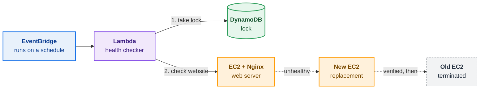

# Self-Healing EC2 Automation

A small AWS project that checks an Nginx web server on EC2 and tries to replace it automatically if it stops working. It is built with Terraform, Lambda, EventBridge and DynamoDB.


> This is a learning project, not production-ready. The full recovery process has not been tested end to end (see [Testing and Results](#testing-and-results)).

## What the Project Does

- **Terraform** creates the AWS infrastructure: a network, an EC2 web server running Nginx, a DynamoDB table, a Lambda function and a schedule.
- **EventBridge** runs the Lambda function on a schedule (every 5 minutes by default).
- **Lambda** checks whether the website on the EC2 server responds.
- **DynamoDB** acts as a lock, so two recovery attempts cannot run at the same time.
- If the server is unhealthy, Lambda launches a **replacement**, checks that it works, and only then terminates the old one.

## How It Works

1. EventBridge starts the Lambda function on schedule.
2. Lambda takes a lock in DynamoDB. If another run already holds it, this run stops.
3. Lambda finds the web server using its tags (`Project` and `ManagedBy`).
4. Lambda sends an HTTP request to the server. If it answers normally, the run ends with "healthy".
5. If the server is stopped or does not answer, Lambda launches a new EC2 instance with the same setup.
6. Lambda waits for the new instance to pass the EC2 status checks and to answer HTTP requests.
7. If the new instance works, Lambda terminates the old one. If not, Lambda terminates the new one and keeps the old one.
8. Lambda releases the lock.

## AWS Architecture



Colors: 🟣 Lambda · 🔵 EventBridge · 🟢 DynamoDB · 🟠 EC2 / Nginx. The dotted arrows are the recovery path, which Lambda carries out. Lambda also writes logs to CloudWatch automatically.

## Technologies Used

- **AWS:** EC2, Lambda, EventBridge, DynamoDB, IAM, VPC, CloudWatch Logs
- **Terraform** (version 1.10 or newer) with remote state in an S3 bucket
- **Python 3.12** (boto3)
- **Nginx** on Amazon Linux 2023
- **GitHub Actions** (a manual workflow that runs init, validate, plan and apply)

## Repository Structure

```text
.github/workflows/terraform-ci.yml   # manual Terraform workflow
lambda/handler.py                    # the health check and recovery code
terraform/                           # main.tf, variables.tf, outputs.tf
tests/test_handler.py                # unit tests
```

## Testing and Results

| What | Result |
|---|---|
| Unit tests and Terraform format check | Passed locally |
| Lambda console test | Returned a **healthy** result (reported by the project author; no log or screenshot is stored in this repository) |
| Replacing an unhealthy server, failure handling, overlapping runs, scheduled runs | **Not tested yet** |

The console test shows that Lambda can find a running server and that the website answered. It does **not** prove that automatic recovery works. That still needs a real test, for example by stopping Nginx and watching what happens.

## Known Limitations

- **Not production-ready.** It has one server in one availability zone, so it is not a high-availability design.
- **The public IP address changes** after a replacement.
- **Terraform does not know about replacement servers.** `terraform destroy` will not delete them, so check for leftover instances by their tags.
- **The Lambda could time out** if a replacement is very slow (the timeout is 300 seconds).
- **Permissions are broad.** The Lambda can manage any EC2 instance in the account. The tag filter exists in the code, not in IAM.
- **The website uses HTTP only**, open to the internet.
- **The CI workflow has no approval step** between plan and apply.
- **There are no alarms or notifications.** The code has few log messages.

## What I Learned

- Describing a full AWS setup as code with Terraform.
- Connecting EventBridge, Lambda, EC2 and DynamoDB with IAM permissions.
- Writing Python with boto3 and using a DynamoDB conditional write as a simple lock.
- Replacing a server safely: create and verify the new one before removing the old one.
- Finding the weak points in my own design, like timeouts, IAM scope and leftover resources.

GitHub: [github.com/sabo1166](https://github.com/sabo1166)
