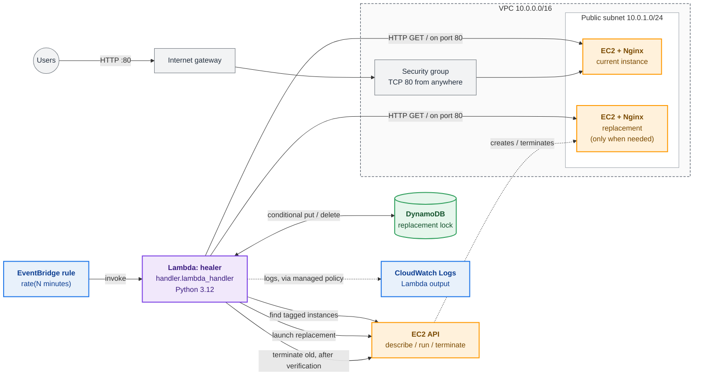
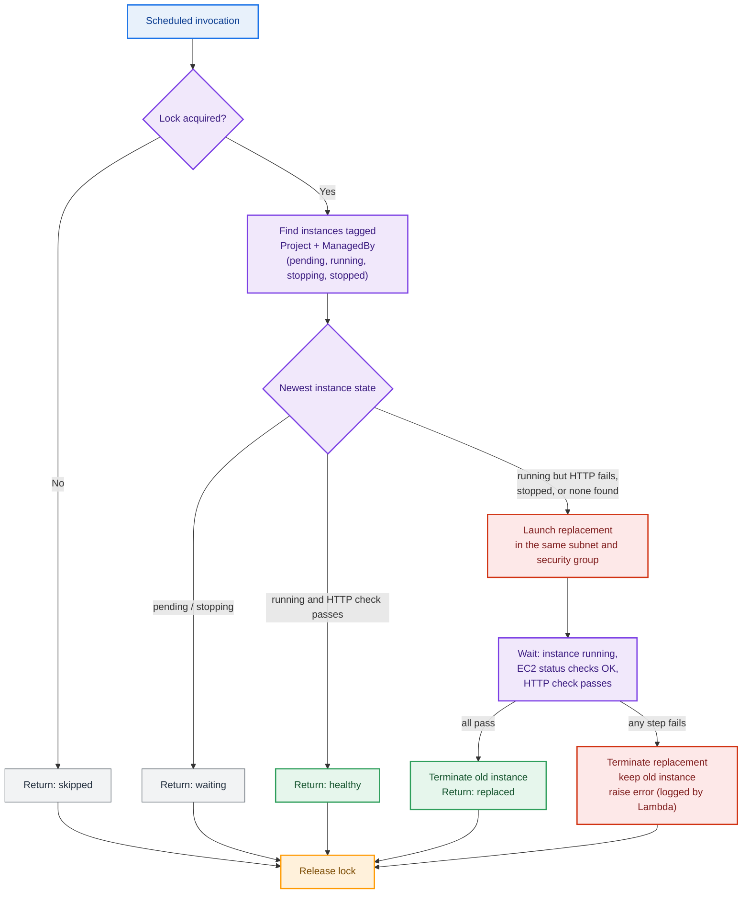

<div align="center">

# Self-Healing EC2 Automation

**A serverless AWS recovery experiment: it monitors an Nginx web server and tries to replace an unhealthy EC2 instance using Lambda, EventBridge, DynamoDB and Terraform.**


</div>

> **Status:** a hands-on learning project, **not production-ready**. The code has local unit tests and one author-reported Lambda console test. The full recovery flow (replace, failure handling, concurrency, scheduled runs) has no recorded evidence yet. See [Testing and verification](#testing-and-verification).

## Contents

[Overview](#overview) · [Key features](#key-engineering-features) · [Architecture](#architecture) · [Recovery workflow](#recovery-workflow) · [Repository](#repository-structure) · [Stack](#technology-stack) · [Configuration](#prerequisites-and-configuration) · [Deployment](#deployment-and-safe-validation) · [Testing](#testing-and-verification) · [Security](#security-design-and-limitations) · [Cost](#cost-and-cleanup) · [Limitations](#known-limitations-and-future-improvements) · [Learning](#learning-outcomes) · [Links](#links)

## Overview

A single web server can fail: Nginx stops, the instance hangs, or someone stops it. This project checks one Nginx instance on a schedule. If the instance looks unhealthy, it launches a replacement and removes the old instance **only after the replacement passes its checks**.

I built it to practise connecting several AWS services, describing them in Terraform, and thinking about what can go wrong: two checks running at once, a replacement that never becomes healthy, or state that Terraform doesn't know about.

## Key engineering features

- **Infrastructure as Code:** VPC, public subnet, internet gateway, security group, EC2, DynamoDB, IAM, Lambda and EventBridge are all defined in Terraform.
- **Scheduled health checks:** an EventBridge rule (`rate(N minutes)`, default 5) invokes the Lambda.
- **Safe replacement order:** launch the new instance, verify it, then terminate the old one. A failed replacement is terminated and the old instance is kept.
- **Execution locking:** a DynamoDB conditional write with an owner token and a lease prevents overlapping replacement attempts.
- **EC2 lifecycle handling:** distinct behaviour for running, stopped, pending and stopping instances.
- **Remote Terraform state:** S3 backend with native lock file (`use_lockfile`).
- **Local tests:** unit tests check the `run_instances` request against botocore's own parameter model.

## Architecture



Solid arrows are direct calls made by the code. Dotted arrows are indirect AWS behaviour. The Lambda runs outside the VPC and reaches the instance over its public IP.

### Components and responsibilities

| Component | Responsibility |
|---|---|
| **EventBridge rule** | Invokes the Lambda on a schedule. A Lambda permission allows only this rule. |
| **Lambda `healer`** | Python 3.12, 256 MB, 300 s timeout. Takes the lock, finds the instance, checks health, replaces if needed, releases the lock. |
| **DynamoDB lock table** | On-demand table with hash key `LockId`. One item, `replacement`, holds an owner token and an expiry time. |
| **EC2 + Nginx** | Amazon Linux 2023 (latest AMI at apply time), `t3.micro` by default. `user_data` installs Nginx and writes a small `index.html`. |
| **VPC, subnet, IGW, route table, security group** | Public network (`10.0.0.0/16`, `10.0.1.0/24`, first available AZ). HTTP port 80 open to the internet. |
| **IAM role** | Lets the Lambda write logs, manage EC2 instances and use the lock table. |
| **CloudWatch Logs** | Receives the Lambda's output through `AWSLambdaBasicExecutionRole`. |

## Recovery workflow



This diagram shows what the code does (`lambda/handler.py`). Most paths have not been run on AWS; see the verification table.

1. **Lock.** `PutItem` on `LockId = "replacement"` succeeds only if no item exists or its `ExpiresAt` has passed (lease 360 s). Otherwise the run returns `skipped`.
2. **Discover.** Instances tagged `Project=<project_name>` and `ManagedBy=SelfHealing` in `pending`, `running`, `stopping` or `stopped` state. Only the **newest** by launch time is evaluated.
3. **Decide.**
   - `pending` or `stopping`: return `waiting`.
   - `running` and `GET http://<public-ip>/` returns 200 to 399 within 5 s: return `healthy`.
   - `running` with a failing HTTP check or no public IP, `stopped`, or no instance: replace.
4. **Replace.** `run_instances` with the same AMI, instance type, `user_data` and tags, using a single network interface that sets the subnet, security group and a public IP.
5. **Verify.** Wait for `running` (up to about 120 s), then for EC2 status checks to pass (up to about 150 s), then try the HTTP check up to 12 times, 5 s apart.
6. **Finish.** On success, terminate the old instance (if one exists) and return `replaced`. On any failure, terminate the replacement, keep the old instance and re-raise the error.
7. **Unlock.** `finally` deletes the lock item only if the owner token still matches.

A **stopped** instance is replaced, not restarted. The Lambda also terminates it after the replacement is verified.

## Repository structure

```text
Self-Healing EC2 Automation/
├── .github/workflows/terraform-ci.yml   # manual workflow: init, validate, plan, apply
├── .gitignore                           # Terraform state, plans, zip, caches
├── README.md
├── lambda/
│   └── handler.py                       # health check, lock, replacement logic
├── terraform/
│   ├── main.tf                          # S3 backend, network, EC2, DynamoDB, IAM, Lambda, EventBridge
│   ├── variables.tf
│   └── outputs.tf
└── tests/
    └── test_handler.py                  # unit tests for the run_instances request
```

Terraform builds `terraform/lambda_function.zip` from `lambda/handler.py` (git-ignored). `.terraform.lock.hcl` is not committed yet; it will appear after the first `terraform init`.

## Technology stack

| Area | Technology |
|---|---|
| Cloud | AWS: EC2, VPC, Lambda, EventBridge, DynamoDB, IAM, CloudWatch Logs, S3 (state) |
| Infrastructure as Code | Terraform ≥ 1.10, AWS provider `~> 5.0`, Archive provider `~> 2.7` |
| Language | Python 3.12 (boto3, urllib), HCL, Bash (`user_data`) |
| Operating system / web server | Amazon Linux 2023, Nginx |
| CI | GitHub Actions (manual `workflow_dispatch`) |

## Prerequisites and configuration

- AWS account and credentials; Terraform ≥ 1.10 (needed for S3 native locking); Python 3.
- An existing S3 bucket for state. The backend in `terraform/main.tf` points to bucket `seconde-state-s3-2026-21`, key `self-healing-ec2/terraform.tfstate`, region `us-east-1`. Terraform does **not** create this bucket. I have not verified its settings; enabling versioning on it is recommended.

| Variable | Default | Meaning |
|---|---|---|
| `aws_region` | `us-east-1` | Region for all resources (the backend region is set separately) |
| `project_name` | `self-healing-ec2` | Name prefix and the `Project` tag used to find instances |
| `instance_type` | `t3.micro` | Instance type for the server and replacements |
| `check_interval_minutes` | `5` | Minutes between checks, validated as 1 to 60 |

Fixed in `main.tf`: VPC `10.0.0.0/16`, subnet `10.0.1.0/24`, health path `/`, lock lease 360 s.
Outputs: `initial_website_url`, `initial_instance_id`, `lambda_function_name`, `health_check_schedule`, `dynamodb_lock_table`.

> **Known issue:** `check_interval_minutes = 1` builds `rate(1 minutes)`, but EventBridge expects `rate(1 minute)` for a value of 1. Use 2 to 60 until this is fixed. I have not tested the value 1 on AWS.

## Deployment and safe validation

**Local checks (no AWS access, no resources)**

```bash
terraform -chdir=terraform fmt -check
terraform -chdir=terraform init -backend=false   # skips the S3 backend
terraform -chdir=terraform validate
python -m py_compile lambda/handler.py
python -m unittest discover -s tests
```

**Commands that contact AWS (read-only, but they touch state)**

```bash
terraform -chdir=terraform init     # reads/configures the S3 backend
terraform -chdir=terraform plan     # reads state and AWS; changes nothing
```

**Commands that create, change or destroy billable resources**

```bash
terraform -chdir=terraform apply
terraform -chdir=terraform destroy
```

Also in this group is the GitHub **Terraform Deploy** workflow (`workflow_dispatch`): `init` and `validate` use `-backend=false`; `plan` and `apply` use the S3 backend, and `apply` applies the saved plan from the `plan` job. **There is no approval step between `plan` and `apply`**, and the AWS keys come from repository secrets.

Before the first run against an account that already has these resources, make sure the remote state matches reality. With empty state, `plan` will show every resource as new, and `apply` would fail on existing names or create duplicates. Import existing resources first, and review the plan before applying anything.

## Testing and verification

| Item | Status | Evidence |
|---|---|---|
| `terraform fmt -check` | Verified (local) | Run locally on the committed code |
| `python -m py_compile`, unit tests (2) | Verified (local) | `tests/test_handler.py` checks the `run_instances` request shape against botocore's `RunInstances` model and the tag, AMI and user-data arguments |
| `terraform validate`, `plan`, `apply` | Not verified here | No recorded output in the repository |
| Lambda console test returns `healthy` | Reported by author | A console test returned `{"status":"healthy","instance_id":"i-…"}`. This is not stored in the repository. It shows one invocation took the lock, found a running instance and passed the HTTP check |
| EventBridge invokes the Lambda on schedule | Not verified | Configured in Terraform; no scheduled-run evidence recorded |
| Stopped or unhealthy instance is replaced | Not verified | Logic read and unit-tested only for the launch arguments |
| Failed replacement keeps the old instance | Not verified | Logic read only |
| Concurrent invocations are skipped | Not verified | Logic read only |
| Expired lock takeover | Not verified | Logic read only |
| Lambda timeout vs. total wait time | Not verified | See limitations |
| CI runs unit tests | Not implemented | The workflow runs `py_compile` only |
| CloudWatch alarms and notifications | Not implemented | |

An earlier deployed version of the Lambda failed with `ParamValidationError` for `AssociatePublicIpAddress` placed at the top level of `run_instances`. The code now sets it inside `NetworkInterfaces`, which the unit tests check locally. The fix is **not** confirmed on AWS.

**Tests still needed:** healthy run; stop Nginx and watch a replacement; stopped instance; failed replacement (for example broken `user_data`); two overlapping invocations; expired lock; slow replacement against the 300 s timeout; scheduled invocation; `destroy` plus manual cleanup.

## Security design and limitations

**Existing controls**

- The Lambda has its own IAM role. DynamoDB access is limited to `PutItem` and `DeleteItem` on the lock table.
- EventBridge may invoke the function only through this rule.
- No SSH port is open and no key pair is attached.
- Lock release is conditional on the owner token.
- The old instance is never terminated before the replacement passes its checks.
- No secrets are stored in the code. State storage uses `encrypt = true`.

**Outstanding risks**

| Risk | Detail |
|---|---|
| EC2 permissions are broad | `DescribeInstances`, `DescribeInstanceStatus`, `RunInstances`, `CreateTags` and `TerminateInstances` use `Resource = "*"` with no conditions. The tag filter exists only in the Python code; IAM does not enforce it. |
| HTTP only, public | Port 80 is open to `0.0.0.0/0`; no HTTPS. |
| Open egress | All outbound traffic is allowed. |
| Instance hardening | IMDSv2 is not required and EBS encryption is not set in the configuration. |
| Health check path | The Lambda is outside the VPC and checks the instance's public IP over the internet. |
| Static CI credentials | The workflow uses long-lived access keys from GitHub secrets rather than OIDC. |
| State and artifacts | State is in S3 (not in Git). `.gitignore` excludes state, plans and the generated zip; the saved plan is uploaded as a one-day workflow artifact. |
| Bucket settings unverified | I have not confirmed versioning, encryption or public-access settings on the state bucket. |

## Cost and cleanup

Resources that can cost money: EC2 instances and their EBS volumes (a replacement briefly means two), public IPv4 addresses, Lambda invocations every interval, DynamoDB on-demand requests, CloudWatch Logs, and the S3 state bucket and its versions. I have not calculated costs; check current AWS pricing.

**What `terraform destroy` will not clean up**

- **Instances created by the Lambda** are outside Terraform state.
- **The Lambda's log group** (`/aws/lambda/<project_name>-healer`) is created by AWS, is not defined in Terraform, and has no retention setting.
- **The S3 state object and its versions.**

**Review before deleting anything by hand**

```bash
aws ec2 describe-instances \
  --filters "Name=tag:Project,Values=self-healing-ec2" "Name=tag:ManagedBy,Values=SelfHealing" \
            "Name=instance-state-name,Values=pending,running,stopping,stopped" \
  --query "Reservations[].Instances[].[InstanceId,State.Name,LaunchTime,VpcId]" --output table
```

Check each ID against the Terraform state and the VPC before terminating it. Remove the scheduler (run `destroy` or disable the rule) first, otherwise the Lambda can launch a new instance after you delete one.

## Known limitations and future improvements

**Confirmed from the code**

- **The public IP changes after a replacement.** There is no Elastic IP, load balancer or DNS, and the `initial_website_url` output goes stale.
- **Terraform drift.** A replacement is not in Terraform state. A later `terraform apply` sees `aws_instance.web` as gone and plans a new instance with the same tags, which the Lambda then also discovers. `destroy` does not remove replacements.
- **Possible Lambda timeout.** Worst-case waits (about 120 s + 150 s + roughly 115 s of HTTP retries) can exceed the 300 s timeout. A timeout could leave a replacement behind with the lock held until its lease expires.
- **Only the newest instance is evaluated.** Older tagged instances, including duplicates, are never touched. Selection is by tag, not by VPC.
- **No grace period** after `running`: an instance still installing Nginx fails the HTTP check and can be replaced unnecessarily.
- **A failed cleanup can hide the original error:** the `terminate_instances` call for a failed replacement is not guarded.
- **Little logging.** The code has no log statements; failures appear only through the uncaught exception and the returned status.
- **Single instance, single AZ.** This is replacement, not high availability.
- **`rate(1 minutes)`** is likely invalid (see configuration).

**Possible next steps**

- [ ] Record real AWS evidence for the tests listed above
- [ ] Restrict EC2 permissions with tag conditions and narrower resources
- [ ] Stable address (Elastic IP, load balancer or DNS) and HTTPS
- [ ] Handle the timeout and clean up orphaned replacements; add a post-launch grace period
- [ ] Add log statements, a log group with retention, and CloudWatch alarms
- [ ] Require IMDSv2, encrypt EBS, restrict egress
- [ ] Add an approval gate before `apply`, run unit tests in CI, use OIDC instead of static keys
- [ ] Commit `.terraform.lock.hcl`
- [ ] Fix the `rate(1 minute)` grammar for an interval of 1

## Learning outcomes

- Writing a multi-service AWS stack in Terraform, including IAM, EventBridge permissions and a remote S3 backend.
- Using a DynamoDB conditional write as a lease-based lock.
- Designing replacement order (verify first, delete last) and thinking through failure paths.
- Using boto3 waiters and calling out a `ParamValidationError` bug through request-shape tests.
- Spotting limits in my own design: IAM scope, Terraform drift, timeouts and cost leftovers.

I'm still learning, and this repository shows my approach rather than production experience.

## Links

- GitHub: [github.com/sabo1166](https://github.com/sabo1166)
- LinkedIn: *(not added yet)*

---

<div align="center">

**Cloud engineering is learned by building, breaking and fixing real systems.**

</div>
