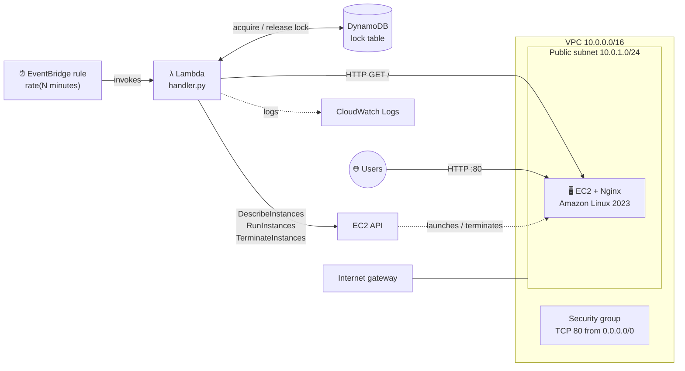
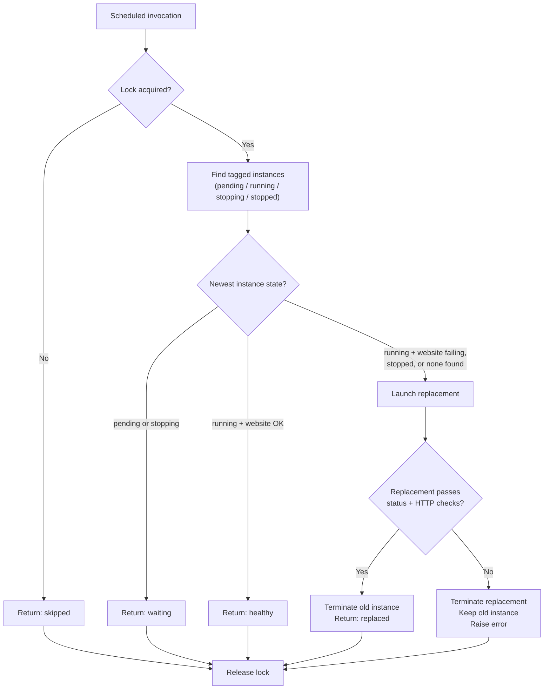

<div align="center">

# 🩺 Self-Healing EC2 Automation

**A serverless health checker that replaces a broken Nginx web server on AWS, built with Terraform and Python.**


</div>

> ⚠️ **Project status:** This is a hands-on learning project. It is **not production-ready**, and the recovery flow has **not yet been tested on a real AWS account** (see [Testing and Verification](#-testing-and-verification)).

---

## 📌 The Problem

A single web server can fail: Nginx stops, the instance hangs, or the instance is stopped or terminated. Without automation, someone has to notice and fix it by hand.

This project checks the server on a schedule and, if it looks unhealthy, launches a new one. It only removes the old server **after** the new one is confirmed working.

## 🧭 About the Project

**Self-healing infrastructure** means the system detects a problem and fixes it without a person stepping in. Here, the "fix" is simple: replace the broken server with a fresh one built from the same recipe.

**Why I built it**

- Practise connecting several AWS services into one working flow.
- Learn to describe the whole setup as code with Terraform.
- Think about safety: what happens if two checks run at once, or a replacement fails?

```yaml
project:
  name: Self-Healing EC2 Automation
  type: Learning project (AWS + Terraform + Python)
  goal: Replace an unhealthy Nginx EC2 instance automatically
  trigger: EventBridge schedule (default every 5 minutes)
  region: us-east-1 (default, configurable)
  iac: Terraform
  runtime: Python 3.12 on AWS Lambda
  safety: DynamoDB lock + verify-before-terminate
  status: Not production-ready, AWS runtime not yet verified
```

---

## 🏗️ Architecture



| Component | Role in this project |
|---|---|
| **EventBridge rule** | Invokes the Lambda on a fixed schedule (`rate(N minutes)`). |
| **Lambda (Python 3.12)** | Finds the current instance, checks the website, and replaces the instance if needed. Timeout 300 s, 256 MB. |
| **EC2 + Nginx** | Public web server. Nginx is installed through `user_data` on Amazon Linux 2023 and serves a simple HTML page. |
| **DynamoDB lock table** | One item (`LockId = "replacement"`) with an owner token and expiry time. A conditional write stops two checks from replacing at the same time. |
| **IAM role** | Lets Lambda write logs, manage EC2 instances, and use the lock table. |
| **CloudWatch Logs** | Receives Lambda logs through the AWS-managed `AWSLambdaBasicExecutionRole` policy. |
| **VPC / subnet / IGW / route table / security group** | Basic public network for the web server. |

**Implemented vs. not implemented**

| Implemented in code | Not implemented |
|---|---|
| Scheduled invocation | CloudWatch alarms or notifications (SNS, email) |
| HTTP health check from Lambda | HTTPS / TLS |
| Launch-verify-then-terminate replacement | Stable address (Elastic IP, load balancer, DNS) |
| DynamoDB lock with expiry | Terraform remote state |
| Tagged-instance discovery | Automated tests |

---

## ⚙️ How It Works



### Step by step

1. **Lock.** The Lambda tries to write a lock item to DynamoDB. It succeeds only if no lock exists or the old lock has expired (lease: 360 s). If it fails, the run is skipped.
2. **Discover.** It looks for EC2 instances tagged `Project=<project_name>` and `ManagedBy=SelfHealing`, and takes the newest one.
3. **Decide.**
   - **Healthy:** instance is `running` and `GET http://<public-ip>/` returns a status from 200 to 399 within 5 seconds. Nothing changes.
   - **Waiting:** instance is `pending` or `stopping`. The run exits and tries again next time.
   - **Unhealthy:** instance is `running` but the website fails, or it is `stopped`, or no instance was found. A replacement is started.
4. **Replace.** A new instance is launched with the same AMI, instance type, subnet, security group, tags, and `user_data`.
5. **Verify.** The Lambda waits for the instance to be `running`, then for EC2 status checks to pass, then retries the HTTP check up to 12 times (5 s apart).
6. **Finish.**
   - **Verified:** the old instance is terminated.
   - **Failed:** the replacement is terminated, the old instance is **kept**, and the error is raised so it shows in the logs.
7. **Unlock.** The lock is released in a `finally` block, only if this run still owns it.

### Known limitations

- **The public IP changes** after a replacement. There is no Elastic IP, load balancer, or DNS record, so the Terraform output `initial_website_url` becomes outdated.
- **Terraform does not know about replacements.** A Lambda-created instance is outside Terraform state. `terraform destroy` will not remove it, so it must be deleted manually (find it by the `Project` / `ManagedBy` tags). A later `terraform apply` may also behave unexpectedly.
- **Possible Lambda timeout.** The waits (running ≈ 2 min, status checks ≈ 2.5 min, HTTP retries ≈ 1 min) can add up to more than the 300 s timeout in a slow case. If that happens, the replacement could be left behind and the lock stays until it expires. I have not tested this.
- **Only the newest instance is checked.** If several tagged instances exist, older ones are ignored.
- **The health check is shallow.** It only tests one HTTP path from outside a VPC; it cannot detect partial failures or wrong content.
- **A failed cleanup can mask the original error.** If terminating the failed replacement also errors, that error is raised instead.
- **Boot-time false positives are possible.** A `running` instance that is still installing Nginx fails the HTTP check, so it could be replaced unnecessarily. The `pending` state is skipped, but there is no grace period after `running`.
- **Single Availability Zone and single instance.** This is self-replacement, not high availability.

---

## 🧰 Technology Stack

| Category | Technology |
|---|---|
| **Cloud** | AWS (VPC, subnet, internet gateway, route table, security group, EC2) |
| **Infrastructure as Code** | Terraform `>= 1.5.0`, AWS provider `~> 5.0`, Archive provider `~> 2.7` |
| **Serverless** | AWS Lambda (Python 3.12), Amazon EventBridge (schedule rule) |
| **Data** | Amazon DynamoDB (on-demand billing) for the lock |
| **Monitoring** | Amazon CloudWatch Logs (Lambda logs only) |
| **Operating system / web server** | Amazon Linux 2023 (x86_64), Nginx |
| **Language** | Python 3.12 (`boto3`, `urllib`), HCL, Bash (`user_data`) |

---

## 📂 Repository Structure

```text
Self-Healing EC2 Automation/
├── .gitignore            # currently empty
├── README.md
├── lambda/
│   └── handler.py        # health check, lock, replace logic
└── terraform/
    ├── main.tf           # network, EC2, DynamoDB, IAM, Lambda, EventBridge
    ├── variables.tf      # input variables
    └── outputs.tf        # useful values after apply
```

Terraform packages `lambda/handler.py` into `terraform/lambda_function.zip` at plan/apply time.

---

## 🔧 Configuration

### Prerequisites

- An AWS account and credentials configured locally (for example `aws configure`)
- [Terraform](https://developer.hashicorp.com/terraform/downloads) `>= 1.5.0`
- Permission to create VPC, EC2, IAM, Lambda, DynamoDB, and EventBridge resources

### Variables

| Variable | Default | Description |
|---|---|---|
| `aws_region` | `us-east-1` | AWS region for all resources. |
| `project_name` | `self-healing-ec2` | Prefix for resource names and the `Project` tag used to find instances. |
| `instance_type` | `t3.micro` | EC2 instance type for the web server and replacements. |
| `check_interval_minutes` | `5` | Minutes between checks. Must be 1 to 60. |

Other values are fixed in `main.tf`: VPC `10.0.0.0/16`, subnet `10.0.1.0/24` (first available AZ), health check path `/`, lock lease `360` seconds.

### Outputs

`initial_website_url`, `initial_instance_id`, `lambda_function_name`, `health_check_schedule`, `dynamodb_lock_table`.

### Safe local validation

These commands do not create AWS resources:

```bash
cd terraform
terraform fmt -check
terraform init -backend=false
terraform validate
python -m py_compile ../lambda/handler.py
```

> `terraform plan` also makes no changes, but it needs valid AWS credentials to look up the AMI and availability zones. Review the plan before any apply.

---

## 🔐 Security

**What is in place**

- The Lambda has its own IAM role.
- DynamoDB permissions are limited to `PutItem` and `DeleteItem` on the lock table only.
- No SSH port is open and no key pair is attached.
- The lock is released only by the invocation that owns it (owner token check).
- A replacement that fails verification never causes the old instance to be deleted.
- No secrets are stored in the code or Terraform files.

**Known weaknesses (not yet fixed)**

| Issue | Detail |
|---|---|
| **EC2 permissions are not least-privilege** | `RunInstances`, `TerminateInstances`, `CreateTags`, and describe actions use `Resource = "*"`. The code filters by tag, but IAM does not enforce it. Tag-based conditions are a planned improvement. |
| **HTTP only** | Traffic on port 80 is unencrypted. No HTTPS or certificate. |
| **Open to the world** | The security group allows port 80 from `0.0.0.0/0`. This is intended for the demo site but is still public exposure. |
| **Open egress** | The instance may send traffic to any destination. |
| **Instance hardening not configured** | IMDSv2 is not enforced and EBS encryption is not set explicitly. |
| **Public-IP health check** | The Lambda checks the instance over the public internet instead of a private path. |
| **Terraform state** | State is local and may contain sensitive data. `.gitignore` is currently empty, so **state files, `.terraform/`, and `lambda_function.zip` could be committed by mistake**. Fix this before pushing to GitHub. |

---

## 💰 Cost Awareness

This project can create billable AWS resources. I have not calculated costs, so check current AWS pricing before deploying.

| Resource | Why it may cost money |
|---|---|
| EC2 instance(s) | Running instance time, and EBS storage. A replacement briefly means two instances at once. |
| Public IPv4 addresses | AWS charges for public IPv4 addresses. |
| Lambda | Invocations and run time (runs on every schedule tick). |
| DynamoDB | On-demand reads and writes (very small here). |
| CloudWatch Logs | Log ingestion and storage. No retention period is set, so logs are kept indefinitely. |
| EventBridge | A scheduled rule; usually minimal. |
| Data transfer | Outbound internet traffic. |

Run `terraform destroy` when done, and also delete any instance the Lambda created (see limitations). Setting an AWS budget alert is a good habit.

---

## ✅ Testing and Verification

| Check | Status |
|---|---|
| Source code and Terraform reviewed by reading | ✅ Done |
| `terraform fmt` / `validate`, `py_compile` | ⏳ Commands documented, not run for this README |
| Automated unit tests | ❌ None in the repository |
| `terraform apply` on a real AWS account | ❌ Not verified |
| Lambda runs on schedule | ❌ Not verified |
| Healthy case returns `healthy` | ❌ Not verified |
| Unhealthy case triggers a replacement | ❌ Not verified |

**No evidence of a real recovery exists yet, so this README does not claim that recovery works.**

### Tests still required

- [ ] `terraform validate` and `terraform plan` succeed
- [ ] Initial instance serves the Nginx page
- [ ] Healthy instance → Lambda returns `healthy`, nothing is changed
- [ ] Stop Nginx (or stop the instance) → replacement launched, verified, old instance terminated
- [ ] Replacement that fails (for example broken `user_data`) → replacement terminated, old instance kept
- [ ] Two overlapping invocations → one is `skipped`
- [ ] Expired lock is taken over correctly
- [ ] Slow replacement vs. the 300 s Lambda timeout
- [ ] CloudWatch Logs show useful output
- [ ] `terraform destroy` plus manual cleanup leaves no leftover resources

---

## 🎓 Learning Outcomes

Working on this project gave me practice with:

- Describing a network, compute, and serverless setup in **Terraform**
- Connecting **EventBridge → Lambda → EC2 / DynamoDB** with IAM permissions
- Writing **Python with boto3**, including waiters and error handling
- Using a **DynamoDB conditional write** as a simple lock
- Designing a **safe replacement order** (verify first, delete last)
- Bootstrapping a server with **user_data**
- Finding and writing down my own design gaps (IAM scope, state drift, timeouts)

I am still learning. This project shows the approach, not expert-level production skill.

---

## 🗺️ Roadmap

- [ ] Run and document a real AWS test, including the failure scenarios
- [ ] Restrict IAM with tag conditions and narrower resources
- [ ] Use an Elastic IP, load balancer, or DNS so the address survives replacement
- [ ] Add HTTPS
- [ ] Handle the Lambda timeout and clean up orphaned replacements
- [ ] Add CloudWatch alarms and notifications (SNS)
- [ ] Set log retention
- [ ] Enforce IMDSv2, encrypt EBS, restrict egress
- [ ] Add unit tests for `handler.py` (mocked AWS calls)
- [ ] Add a remote Terraform backend and a populated `.gitignore`
- [ ] Add a CI workflow for `fmt`, `validate`, and tests
- [ ] Consider an Auto Scaling group as a managed alternative

---

## 🤝 Connect

- GitHub: [github.com/sabo1166](https://github.com/sabo1166)
- LinkedIn: *(placeholder: replace with your LinkedIn URL, or delete this line)*

Feedback and suggestions are welcome.

---

<div align="center">

**Cloud engineering is learned by building, breaking, and fixing real systems. 🚀**

</div>
